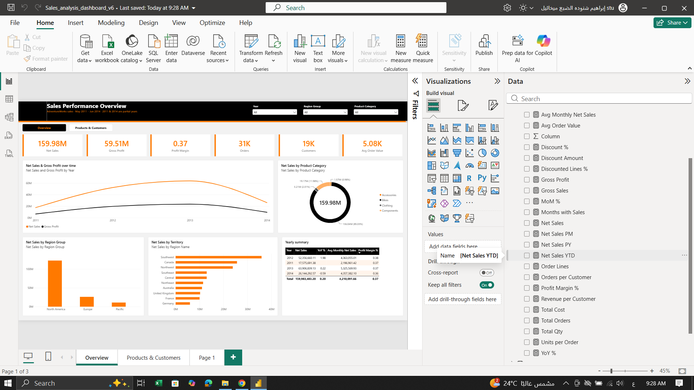
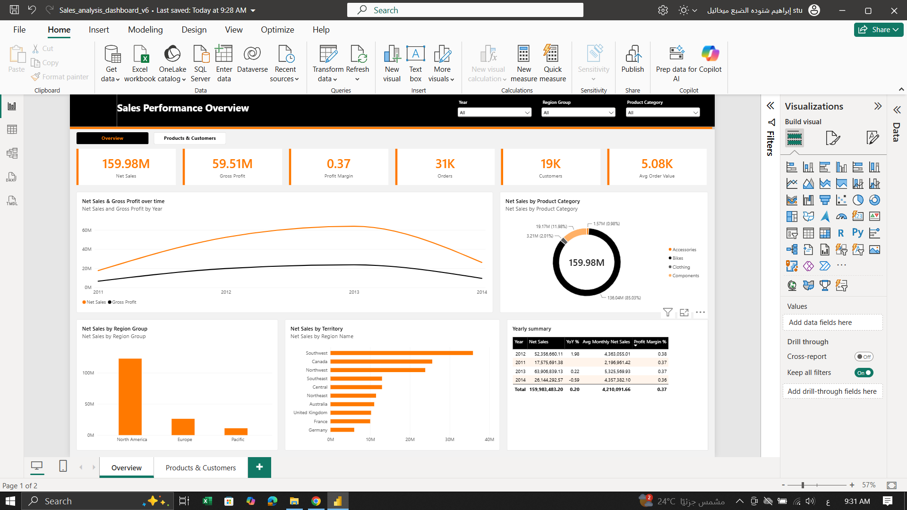
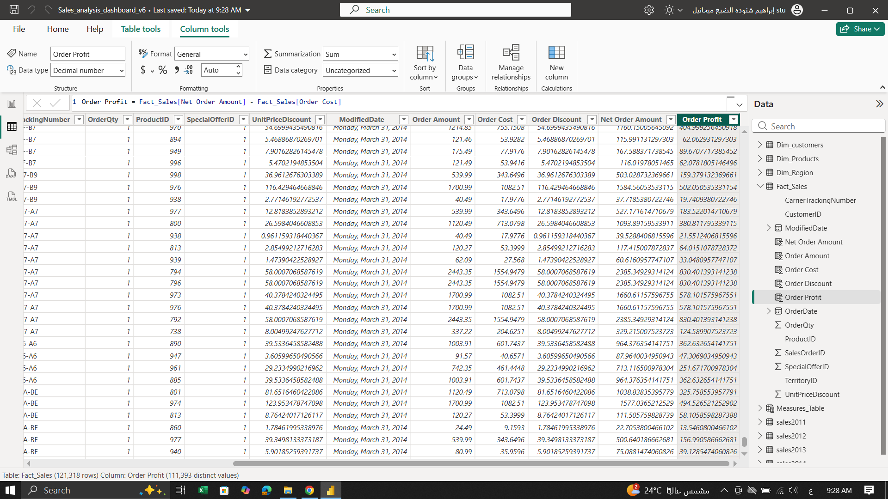

# AdventureWorks Sales Performance Dashboard (Power BI)


A 2-page Power BI report on **121K sales lines (May 2011 – Jun 2014)** for AdventureWorks, a bike manufacturer. It covers sales, profit, regions, products and top customers, with year, region and category filters.



## Business questions

1. How did net sales and gross profit change year over year?
2. Which regions and territories sell the most?
3. Which categories and products make the money, and how much do discounts cost?
4. Who are the most valuable customers?

## Key numbers

| KPI | Value |
|---|---|
| Net sales | **159.98M** |
| Gross profit | 59.51M |
| Profit margin | **37%** |
| Orders | 31K |
| Customers | 19K |
| Avg order value | 5.08K |
| Units sold | 275K |
| Discount amount | 10.98M (6.42%) |

## Insights

- **Bikes are 85% of net sales** (136.0M). Accessories are only about 1%, but they have the **highest margin** of any category.
- **North America is the largest region by far**, and Southwest is the top territory.
- **2012 sales were about 3x 2011** (52.4M vs 17.6M, +198%) and grew another 22% in 2013 (63.9M). (2011 and 2014 are partial years.)
- **Mountain-200 bikes are the top products**: the top 6 products are all Mountain-200 models with a 42% margin.
- **Discounts cost 10.98M (6.4% of sales)**; Accessories get the highest discount % even though they sell the least.

## Recommendations

- Sell more accessories with every bike: they have the highest margin and a small share today.
- Review the Accessories discount policy, since it has the highest discount on the smallest category.
- Use the North America playbook to grow Europe and Pacific.

## Dashboard pages

| Overview | Products & customers |
|---|---|
|  |  |

## Process

1. **Power Query:** cleaned and combined the yearly sales tables (2011–2014) into one fact table.
2. **Data model:** star schema: `Fact_Sales` with `Dim_Customers`, `Dim_Products`, `Dim_Region` and a date table.
3. **Calculated columns:** Order Amount, Order Cost, Order Discount, Net Order Amount, Order Profit.
4. **DAX measures (25+):** Net Sales, Gross Profit, Profit Margin %, Avg Order Value, YoY %, MoM %, Net Sales YTD / PY / PM, Discount %, Revenue per Customer, Units per Order.



## Files

```text
Sales_analysis_dashboard.pbix   Power BI report
data/                           Sales, Customers, Products, Regions (Excel)
images/                         screenshots
```

## How to open

Download `Sales_analysis_dashboard.pbix` and open it with [Power BI Desktop](https://www.microsoft.com/power-platform/products/power-bi/desktop) (free).

---

**Ibrahim Shnouda** · [LinkedIn](https://linkedin.com/in/ibrahim-shenouda) · [GitHub](https://github.com/ibrahemshenouda)
